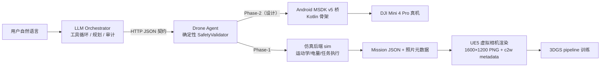
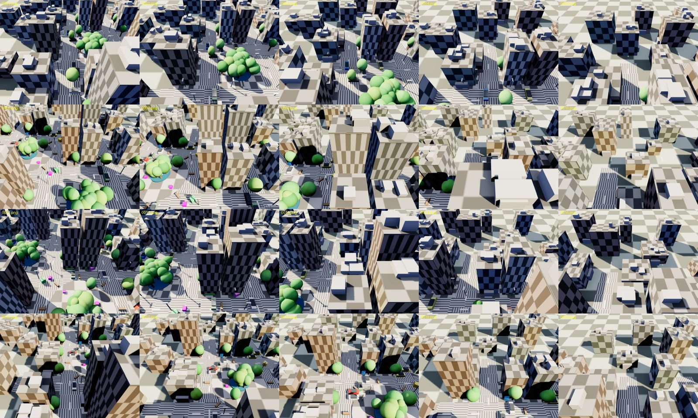
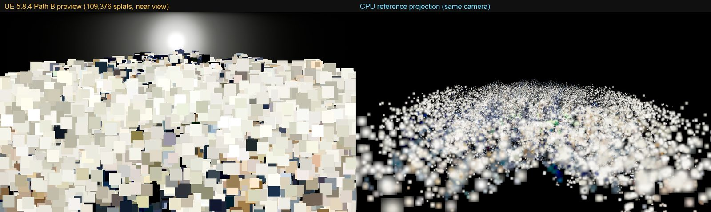

# DJI Mini × UE5 × 3DGS ＋ LLM Tool-Call 无人机调度

> 两阶段技术验证仓库：**① DJI Mini 航拍 → 3DGS 重建 → UE5 渲染** 的可行性；**② LLM Tool-Call 安全调度无人机完成任务**（Phase-1 仿真+UE5，Phase-2 真机桥设计）。

    

## 1. 这个仓库是什么

本仓库由两个前后衔接的阶段组成，均为**可复现的工程验证**而非纯理论文档：

| 阶段 | 目标 | 主要目录 | 结论 |
|---|---|---|---|
| **Phase-0**（已完成） | 验证“DJI Mini 拍摄 → 3DGS 重建 → UE5 集成”技术可行性 | `capture/`、`pipeline/`、`ue5/`、`report/`、`docs/research/01-07` | 可行：合成航拍数据集 + 自研 3DGS 训练 + UE5.8 插件移植/渲染跑通；详见 [Phase-0 报告](report/DJI_Mini_UE5_3DGS_可行性验证报告.md) |
| **Phase-1**（已完成） | 验证“自然语言 → LLM 工具调用 → 安全校验 → 无人机任务执行 → 航拍数据 → 3DGS”闭环 | `llm_drone/`、`docs/research/08-10` | 可行：真实本地 LLM 驱动 13/13 演示场景 PASS；UE5 虚拟相机渲染真实 LLM 任务 20 帧；MSDK v5 真机桥完成设计与代码骨架（未真机） |

**核心原则**：LLM 永远不直连 DJI SDK；所有飞行指令必须通过确定性安全层（限高/限速/围栏/禁飞区/电量/GPS/链路/二次确认/审计）。

## 2. 系统架构



Phase-0 数据链路：`DJI Mini 航拍/合成渲染 → EXIF/XMP + COLMAP → 3DGS 训练 → PLY → UE5 3DGS 插件渲染`。

## 3. 仓库结构

```
dji_ue5_3dgs/
├── llm_drone/              # ★ Phase-1：LLM 调度无人机（Python 纯标准库）
│   ├── spec/               #   冻结规格（协议/工具/mission schema）——实现唯一事实源
│   ├── orchestrator/       #   LLM 工具循环、规划器、审计、demo CLI
│   ├── sim/ safety/        #   仿真 Agent + 确定性安全层
│   ├── tests/              #   单测（sim/safety/orchestrator）+ Lead 黑盒验收脚本
│   ├── demo/runs/          #   13 个最终 PASS + 12 个失败重试 run（可复核证据）
│   ├── msdk_bridge/        #   Phase-2 Android MSDK v5 桥（设计 + Kotlin 骨架 + 真机协议）
│   ├── ue5_mission/        #   Mission JSON → UE5 渲染 + 真值 metadata
│   └── docs/               #   契约、最终报告、验收报告
├── pipeline/               # Phase-0：3DGS 重建流水线（PyTorch）
├── capture/                # Phase-0：UE5 合成航拍数据生成（相机轨迹/渲染/元数据）
├── ue5/                    # Phase-0：UE5.8 工程 + 3DGS 插件移植 + 渲染结果
├── report/                 # Phase-0：可行性报告、PPTX、图表、复现脚本
├── docs/                   # 模型调研（DJI SDK/航线/元数据）、索引、环境说明、图片
├── shared/                 # 跨阶段数据契约（坐标系/metadata/PLY）与校验脚本
├── data/                   # 数据说明 + 小样例（大数据不入库，见 data/README.md）
└── .github/                # CI（单测）与 PR 模板
```

## 4. 快速开始

### 4.1 Phase-1：LLM 调度无人机（3 分钟）

前置：Windows/Linux、Python 3.12+（本项目用 3.14 验证）、[Ollama](https://ollama.com/) + `qwen3.5:4b`（可选，用于真实 LLM）。

```powershell
cd dji_ue5_3dgs/llm_drone

# 1) 启动仿真无人机（127.0.0.1:8765，20 倍时间加速）
python -m sim.server --port 8765 --time-scale 20

# 2) 另开终端：跑演示（真实 LLM；A6-A10 自动 scripted）
python -m orchestrator.run_demo --agent-url http://127.0.0.1:8765 --scenario all --out demo/runs

# 3) 单测（~118 tests）与独立黑盒验收（27 项）
python -m unittest discover -s tests -v
python logs\lead\verify_acceptance.py --port 8766
```

没有 Ollama 时可用 `--scripted` 做确定性演示（工具调用序列预置）；真实 LLM 证据见 [orchestrator 汇总](llm_drone/logs/orchestrator/SUMMARY.md)。

### 4.2 Phase-0：3DGS + UE5

```powershell
cd dji_ue5_3dgs
pipeline\setup_env.ps1                     # 创建 pipeline 虚拟环境（见 pipeline/ENV.md）
capture\run_capture.ps1 -Mode full         # UE5 合成航拍数据集（需 UE 5.8.4 + GPU）
pipeline\.venv\Scripts\python.exe pipeline\03_train_3dgs.py --data data/synthetic/capture --out data/trained/capture/run1 --iters 3000 --backend puretorch
```

详细步骤：`pipeline/README.md`、`capture/README.md`、`ue5/`；结论见 [Phase-0 报告](report/DJI_Mini_UE5_3DGS_可行性验证报告.md)。

## 5. 验证结果摘要

### Phase-1（LLM 调度）

| 项 | 结果 |
|---|---|
| 演示场景 | **13/13 PASS**（P1-P3 真实 LLM：20/12/5 张照片；A1-A5 真实 LLM 触发安全拒绝；A6-A10 scripted 直调） |
| 独立黑盒验收 | **27/27 PASS**（[JSON](llm_drone/logs/lead/acceptance_20261108_221327.json)） |
| 单元测试 | **118 tests OK** |
| UE5 任务渲染 | 16 帧预置样例 + **20 帧真实 LLM 任务**，1600×1200，c2w/GPS/云台误差 0，校验 ok=true，可接 3DGS |
| MSDK v5 桥 | 23 个 Kotlin 文件 + 工具→API 映射 + 真机测试协议（**未编译、未真机**） |



### Phase-0（3DGS/UE5）

| 项 | 结果 |
|---|---|
| 合成航拍数据集 | 175 train + 15 val @1600×1200（UE5.8 程序化场景） |
| 3DGS 训练 | 自研 pure-PyTorch 光栅化；3000 iter / ~10.9 万 splat / val PSNR 13.28 |
| UE5 集成 | Italink 3DGS 插件移植 UE5.8 编译通过；Path B 点云渲染 4 视角 + 性能测试 |



## 6. 文档导航

全部文档见 **[docs/INDEX.md](docs/INDEX.md)**，常用入口：

- [LLM 调度最终报告（含 DJI Mini SDK 使用方法 + Phase-1 全部实测）](llm_drone/docs/LLM调度无人机方案与验证报告.md)
- [Phase-1 验收报告](llm_drone/docs/ACCEPTANCE.md) ｜ [冻结规格](llm_drone/spec/PROTOCOL.md) ｜ [工具定义](llm_drone/spec/tools.json)
- [DJI MSDK v5 使用方法（代码级）](docs/research/08_MSDKv5_Android使用方法.md) ｜ [MSDK v4 / Mini 2](docs/research/09_MSDKv4_使用方法与Mini2链路.md) ｜ [KMZ/WPML 航线](docs/research/10_KMZ_WPML航线格式与任务下发.md)
- [DJI Mini SDK 能力矩阵](docs/research/01_DJI_Mini_SDK能力矩阵.md) ｜ [Phase-0 最终报告](report/DJI_Mini_UE5_3DGS_可行性验证报告.md) ｜ [Phase-0 简报 PPTX](report/DJI_Mini_UE5_3DGS_可行性验证_简报.pptx)
- [环境搭建](docs/SETUP.md) ｜ [数据说明](data/README.md) ｜ [贡献指南](CONTRIBUTING.md)

## 7. 数据与可复现性

本仓库**只跟踪源代码、文档、配置和小样例**；大数据/构建产物/日志不入库（见 `.gitignore` 与 [data/README.md](data/README.md)）：

| 内容 | 在仓库中 | 如何获得 |
|---|---|---|
| 小样例（真实样片缩略/UE5 渲染 4 帧/COLMAP 元数据） | ✅ `data/samples/` | 直接使用 |
| 合成航拍数据集（175+15 帧，~900 MB） | ❌ | `capture/run_capture.ps1 -Mode full` |
| 3DGS 训练产物 PLY | ❌ | `pipeline/03_train_3dgs.py` |
| UE5 构建产物 / 虚拟环境 / 运行日志 | ❌ | 本地生成 |
| 原始 DJI 调研证据（HTML/PDF 抓取） | ❌（版权+体积） | 按 `docs/research/references.md` 的 URL 重新抓取 |
| 演示 run 证据（transcript/审计/metrics） | ✅ `llm_drone/demo/runs/` | 直接复核 |

## 8. 环境要求

详见 **[docs/SETUP.md](docs/SETUP.md)**。摘要：Windows 11 / Python 3.14（orchestrator 仅标准库）/ NVIDIA GPU（3DGS+UE5 渲染）/ UE 5.8.4（中文路径需 ASCII junction）/ Ollama + qwen3.5:4b；Phase-2 真机需 DJI Mini 4 Pro + RC-N2/N3 + Android。

## 9. 协作与 CI

- 提交前跑单测与验收脚本，见 [CONTRIBUTING.md](CONTRIBUTING.md)；CI 配置在 `.github/workflows/tests.yml`。
- 新增场景/工具必须同步 `llm_drone/spec/` 与测试；涉及安全层改动需要对抗测试。
- 大文件请勿提交（GitHub 单文件 >100 MB 会被拒）。

## 10. 已知限制（诚实清单）

1. **Phase-2 真机未执行**：MSDK 桥未编译、未连接飞控、未飞行；KMZ/WPML 是否被 Mini 4 Pro 接受是最高风险未验证项。
2. **A6–A10 对抗场景为 scripted 直调**（A1–A5 为真实 LLM 触发），已在证据中标注。
3. **真实 LLM 依赖工程辅助**：4B 模型需 `num_ctx=16384` + 阶段感知续跑提醒 + 只读熔断；更大模型未系统评测。
4. **UE5 为程序化仿真场景**，证明数据/坐标/契约链路，不等价真机航拍质量。
5. Phase-0 遗留：Niagara splat 尺度失配、COLMAP 精化实测、EXIF 转换脚本、orbit 演示视频（见报告附录 C）。

## 11. 合规、引用与许可

- 本项目为独立技术验证，与 DJI 无隶属关系；不修改固件、不绕过地理围栏/限高/限速；真机须遵守当地空域法规与 DJI 条款。
- 第三方组件/数据来源与商标声明见 **[NOTICE.md](NOTICE.md)**；引用信息见 **[CITATION.cff](CITATION.cff)**。
- 代码许可证：**TBD**（在许可证确定前默认仅限协作方按内部约定使用）。

---

*所有量化结论均可在对应日志 / JSON / 报告中复核；`llm_drone/` 的规格与验收口径见 [CONTRACT.md](llm_drone/docs/CONTRACT.md) 与 [ACCEPTANCE.md](llm_drone/docs/ACCEPTANCE.md)。*
