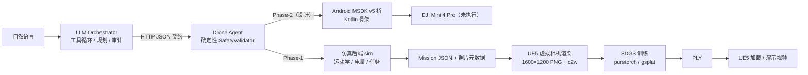

# DJI Mini × UE5 × 3DGS + LLM Tool-Call 无人机调度

> 两个可复现阶段串成的一条端到端链路：**① DJI Mini 航拍 → 3DGS 重建 → UE5.8 渲染**；**② 自然语言 → LLM 工具调用 → 确定性安全层 → 无人机任务 → 航拍数据 → 3DGS**。
> 无真机飞行；Phase-1 全部在仿真 + UE5 虚拟相机中完成，Phase-2 真机桥仅交付设计与代码骨架。

     

## 1. 这个仓库是什么

这是一份**可复现的工程验证仓库**（不是纯理论文档）：每条结论都有落盘证据（JSON / 日志 / 渲染图），关键命令都能在本机重跑。

| 阶段 | 目标 | 主要目录 | 结论 |
|---|---|---|---|
| **Phase-0** | 验证“DJI Mini 拍摄 → 3DGS 重建 → UE5 集成”技术可行性 | `capture/` `pipeline/` `ue5/` `report/` `docs/research/01-07` | 可行（PoC 级）：UE5 合成航拍数据集 + 自研 3DGS 训练 + UE5.8 插件移植跑通 |
| **Phase-1** | 验证“自然语言 → LLM 工具调用 → 安全校验 → 无人机任务 → 航拍数据 → 3DGS”闭环 | `llm_drone/` `docs/research/08-10` | 可行：真实本地 LLM 驱动 **13/13** 场景 PASS；UE5 虚拟相机渲染真实 LLM 任务；MSDK v5 真机桥设计完成（未真机） |
| **3DGS 演示片系列** | 把“同场景航拍 → 3DGS → UE5 预览”做成可展示的演示视频 | `report/scene_v3/`（本地，不入库）、`pipeline/`、`ue5/` | v4 → v5 → v6：v6 用 **gsplat CUDA 后端**重训（199,298 splat、40k iter、960×720、val PSNR 16.62 dB），结果页重建首次可辨认园区 |

**核心原则**：LLM 永远不直连 DJI SDK；所有飞行指令必须通过 Drone Agent 侧的确定性安全层（限高 / 限速 / 围栏 / 禁飞区 / 电量 / GPS / 链路 / 二次确认 / 审计），审计日志不可关闭。

## 2. 亮点

- **真实 LLM 工具循环**：本机 Ollama `qwen3.5:4b` 原生 tool-calls 驱动 15 个工具，13/13 场景 PASS（P1-P3 正向真实 LLM 拍 20/12/5 张；A1-A5 真实 LLM 触发安全拒绝）；
- **确定性安全层**：120 m 限高、15 m/s 限速、300 m 圆形围栏、禁飞多边形、起飞电量 ≥30%、返航保留 20%、GPS fix≥3/卫星≥10、RC 链路、工具白名单、JSON Schema、`confirm=true`、20 个结构化错误码；
- **同一契约双后端**：仿真 Agent 与 Phase-2 Android MSDK v5 桥共用一套 HTTP JSON API，Orchestrator 零改动切换；
- **闭环到 3DGS**：LLM 任务照片 / UE5 渲染帧直接落成 `shared/CONVENTIONS.md` 的 metadata.json，可被 `pipeline/` 训练；
- **40× 加速的 3DGS 后端**：在 Windows + RTX 5060（sm_120）+ CUDA 13.5 上打通 gsplat，960×720、199k splat 下前向+反向 **4.5 ms/iter**（纯 PyTorch 为 189 ms），显存仅 260 MB；
- **Agent-friendly**：`AGENTS.md` + 可复制的 `docs/AGENT_PROMPT.md` + `CLAUDE.md` + Copilot 指令，四层入口，交代清楚“在哪改、怎么跑、什么不能碰”。

## 3. 系统架构



## 4. 仓库结构

```
dji_ue5_3dgs/
├── llm_drone/              # ★ Phase-1：LLM 调度无人机（Python 标准库）
│   ├── spec/               #   冻结规格：HTTP API / 15 工具 / mission / 安全 / 错误码
│   ├── orchestrator/       #   LLM 工具循环、规划器、审计、demo CLI
│   ├── sim/ safety/        #   仿真 Agent + 确定性 SafetyValidator
│   ├── tests/              #   118 个单测 + Lead 黑盒验收脚本（27 项）
│   ├── demo/runs/          #   13 个最终 PASS + 12 个失败重试 run（可复核证据）
│   ├── msdk_bridge/        #   Phase-2 设计 + Kotlin 骨架 + 真机测试协议（未编译/未飞）
│   └── ue5_mission/        #   mission JSON → UE5 渲染 + 真值 metadata
├── pipeline/               # Phase-0：3DGS 流水线（自研 pure-PyTorch + 可选 gsplat）
├── capture/                # Phase-0：UE5 合成航拍数据生成
├── ue5/                    # Phase-0：UE5.8 工程 + Italink 3DGS 插件移植
├── report/                 # Phase-0：可行性报告 / PPTX / 图表 / 视频生成脚本
├── docs/                   # 调研（DJI SDK/航线/元数据）、索引、环境、QUICKSTART/KNOWN_ISSUES
├── shared/                 # 跨阶段数据契约（坐标系 / metadata / PLY）
└── data/                   # 数据说明 + 小样例（大数据不入库）
```

## 5. 快速开始（3 分钟）

前置：Python 3.12+（本项目用 3.14 验证）；Phase-1 零第三方依赖。

```powershell
cd dji_ue5_3dgs/llm_drone
python -m unittest discover -s tests -v            # 118 tests OK
python logs\lead\verify_acceptance.py --port 8766  # 27/27 PASS（自动起仿真 Agent）
```

跑一次确定性演示（不需要 LLM）：

```powershell
# 终端 A：仿真无人机
python -m sim.server --port 8765 --time-scale 20
# 终端 B：P1 场景（预置工具序列）
python -m orchestrator.run_demo --agent-url http://127.0.0.1:8765 --scenario P1 --scripted-for P1 --out demo/runs
```

完整上手（含真实 LLM、3DGS 训练、UE5 渲染、常见坑）：见 **[docs/QUICKSTART.md](docs/QUICKSTART.md)**。

### 5.1 不想装 UE？直接用打包演示包

[**Windows 免安装演示包**](docs/DEMO_WIN64.md)（GitHub Release v1.0 资产，约 1 GB）：解压 → 双击 `run_demo.bat`，即可在 UE5.8 packaged build 里实时查看 v6 3DGS 模型；无需安装 Unreal Engine / CUDA / Python。

## 6. 验证结果摘要

### Phase-1（LLM 安全调度）

| 项 | 结果 | 证据 |
|---|---|---|
| 演示场景 | **13/13 PASS**（P1-P3 真实 LLM；A1-A5 真实 LLM 触发拒绝；A6-A10 scripted 直调） | `llm_drone/demo/runs/`（25 个 run，十件套齐全） |
| 独立黑盒验收 | **27/27 PASS** | [acceptance JSON](llm_drone/logs/lead/acceptance_20261108_221327.json) |
| 单元测试 | **118 tests OK** | `python -m unittest discover -s tests -v` |
| UE5 任务渲染 | 16 帧样例 + 20 帧真实 LLM 任务（1600×1200，c2w/GPS/云台校验 ok） | `llm_drone/ue5_mission/results/` |
| MSDK v5 桥 | 23 个 Kotlin 文件 + 15/15 工具映射 + 真机测试协议（**未编译、未真机**） | `llm_drone/msdk_bridge/` |


### Phase-0（3DGS + UE5）

| 项 | 结果 |
|---|---|
| 合成航拍数据集 | 175 train + 15 val @1600×1200（UE5.8 程序化场景，805 actors） |
| 3DGS 训练 | 自研 pure-PyTorch 光栅化：109,376 splat / 3000 iter / val PSNR 13.28（8 GB 显存仅用 1.15 GB） |
| UE5 集成 | Italink 插件移植 UE5.8 编译通过；Path B 点云预览 4 视角 30.8 fps；Path A（Niagara）仍未闭环 |
| 交付物 | 可行性报告（68 KB）、13 页 PPTX、5 张图、4 条演示视频（本地，不入库） |


### 3DGS 演示片 v4 → v6（同一 v3 场景）

| 版本 | 后端 | 迭代 | splat | 训练分辨率 | val PSNR / SSIM | 全分辨率 val PSNR |
|---|---|---|---|---|---|---|
| v4 | puretorch | 3,000 | 54,812 | 640×480 | 13.92 / 0.43 | 12.34（v5 同口径） |
| v5 | puretorch | 10,000 | 54,812 | 640×480 | 13.30 / 0.43 | 12.34 / 0.47 |
| **v6** | **gsplat** | **40,000** | **199,298** | **960×720** | **16.62 / 0.61** | **16.34 / 0.65** |

> v4/v5/v6 的视频、PLY、渲染帧体积较大，**不入库**；复现命令见 [docs/RESULTS.md](docs/RESULTS.md) 与 [docs/QUICKSTART.md](docs/QUICKSTART.md)。

## 7. 文档导航

全部文档见 **[docs/INDEX.md](docs/INDEX.md)**；常用入口：

- [docs/QUICKSTART.md](docs/QUICKSTART.md)：从 0 跑通（基线、演示、3DGS、UE5、常见坑）
- [docs/RESULTS.md](docs/RESULTS.md)：全部量化结论与证据位置（可复核）
- [docs/KNOWN_ISSUES.md](docs/KNOWN_ISSUES.md)：已知问题、文档漂移、环境限制（先读再改）
- [LLM 调度最终报告](llm_drone/docs/LLM调度无人机方案与验证报告.md)（含 DJI Mini SDK 代码级用法）
- [冻结规格](llm_drone/spec/PROTOCOL.md) ｜ [15 工具定义](llm_drone/spec/tools.json) ｜ [Phase-1 验收](llm_drone/docs/ACCEPTANCE.md)
- [Phase-0 报告](report/DJI_Mini_UE5_3DGS_可行性验证报告.md) ｜ [Phase-0 简报](report/DJI_Mini_UE5_3DGS_可行性验证_简报.pptx)
- [DJI MSDK v5 代码级指南](docs/research/08_MSDKv5_Android使用方法.md) ｜ [KMZ/WPML 航线](docs/research/10_KMZ_WPML航线格式与任务下发.md)
- [环境搭建](docs/SETUP.md) ｜ [数据说明](data/README.md) ｜ [贡献指南](CONTRIBUTING.md)

## 8. 给 AI Agent 的快速上手

本仓库按“人类 + AI Agent”协作设计，四层入口：

| 文件 | 用途 |
|---|---|
| [AGENTS.md](AGENTS.md) | **权威 Agent 指南**：仓库地图、基线命令、硬约束、任务 playbook、已知边界 |
| [docs/AGENT_PROMPT.md](docs/AGENT_PROMPT.md) | 可直接复制的交接提示词（中/英） |
| [CLAUDE.md](CLAUDE.md) / [.github/copilot-instructions.md](.github/copilot-instructions.md) | 其他 Agent 工具入口 |
| [docs/KNOWN_ISSUES.md](docs/KNOWN_ISSUES.md) | 先读：避免把已知问题当 bug 修错 |

> 最小交接：把 `AGENTS.md` + `docs/AGENT_PROMPT.md` 发给对方 Agent，先跑基线（118 tests + 27/27 验收），再声明计划、做最小改动。

## 9. 数据与可复现性

仓库**只跟踪源代码、文档、配置和小样例**；大数据 / 构建产物 / 日志 / 演示视频不入库（见 `.gitignore` 与 [data/README.md](data/README.md)）：

| 内容 | 在仓库中 | 如何获得 |
|---|---|---|
| 小样例（真实样片缩略、UE5 渲染 4 帧、COLMAP 元数据） | ✅ `data/samples/` | 直接使用 |
| 合成航拍数据集（175+15 帧，~900 MB） | ❌ | `capture/run_capture.ps1 -Mode full` |
| 3DGS 训练产物（PLY / metrics / renders） | ❌ | 见 [docs/QUICKSTART.md](docs/QUICKSTART.md) |
| UE5 构建产物 / 虚拟环境 / 运行日志 | ❌ | 本地生成 |
| 演示视频（v4/v5/v6） | ❌ | `report/scene_v3/make_flight_video_v*.py`（脚本与原始帧在本地） |
| demo run 证据（transcript / 审计 / metrics 十件套） | ✅ `llm_drone/demo/runs/` | 直接复核，或 `python logs/orchestrator/_verify_runs.py` |

## 10. 环境要求

摘要：Windows 11（实测）/ Linux 可跑 Phase-1 与 pipeline 单测；Python 3.12+；NVIDIA GPU（3DGS + UE5 渲染，8 GB 可跑）；UE 5.8.4（中文路径需 ASCII junction `C:\UEW`）；可选 Ollama + `qwen3.5:4b`。
3DGS 的 gsplat 后端需要 CUDA 工具链（可用 pip 包 `nvidia-cuda-nvcc/runtime/cccl` + `_CL_=/Zc:preprocessor` 方案，见 [docs/SETUP.md](docs/SETUP.md) 与 `pipeline/README.md`）。

详见 **[docs/SETUP.md](docs/SETUP.md)**。

## 11. 协作与 CI

- 提交前跑单测与验收（见 [CONTRIBUTING.md](CONTRIBUTING.md)）；CI 配置 `.github/workflows/tests.yml`（Windows + Python 3.14：单测 + 27 项黑盒验收）。
- 新增工具/场景必须同步 `llm_drone/spec/` 与测试；安全层改动必须补对抗测试。
- 单文件请保持 < 2 MB；大数据请走“生成脚本 + 小样例”的方式。

## 12. 已知限制（诚实清单）

1. **真机未执行**：MSDK 桥未编译、未连接飞控、未飞行；KMZ 是否被 Mini 4 Pro 接受是最高风险未验证项；
2. **A6-A10 为 scripted 直调**（A1-A5 为真实 LLM 触发），证据中已标注；
3. **真实 LLM 依赖工程辅助**：4B 模型需 `num_ctx=16384` + 阶段感知续跑提醒 + 只读熔断；更大模型未系统评测；
4. **UE5 是程序化仿真场景**，证明数据/坐标/契约链路，不等价真机画质；Niagara splat 渲染仍有尺度问题；
5. 3DGS 重建质量受训练视角/迭代限制，v6 结果页虽可辨认，但细节仍偏软。

更细的 20+ 条（规格/代码差异、文档漂移、证据口径）见 **[docs/KNOWN_ISSUES.md](docs/KNOWN_ISSUES.md)**。

## 13. 合规、引用与许可

- 本项目为独立技术验证，与 DJI 无隶属关系；不修改固件、不绕过地理围栏/限高/限速；真机须遵守当地空域法规与 DJI 条款。
- 第三方组件/数据来源与商标声明见 **[NOTICE.md](NOTICE.md)**；引用信息见 **[CITATION.cff](CITATION.cff)**。
- 代码许可证：**[MIT](LICENSE)**（第三方组件保留各自许可）。

---

*所有量化结论均可在对应日志 / JSON / 报告中复核；Phase-1 规格与验收口径见 [CONTRACT.md](llm_drone/docs/CONTRACT.md) 与 [ACCEPTANCE.md](llm_drone/docs/ACCEPTANCE.md)。*
