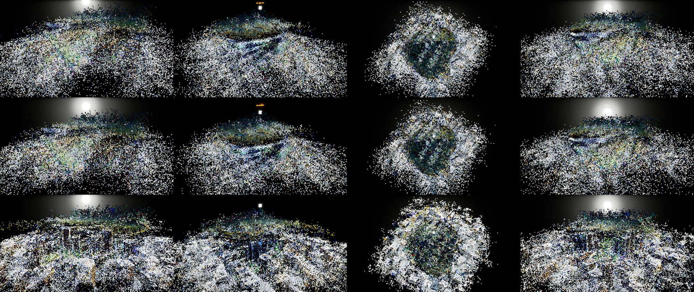
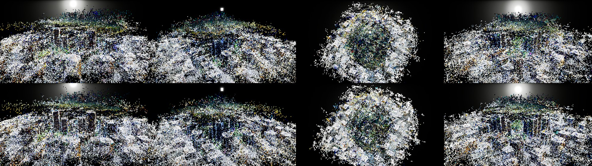

# RESULTS — 量化结论与证据索引

> 原则：每个数字都能回溯到仓库内的文件；没有落盘证据的数字不写。
> 大体积产物（数据 / PLY / 视频 / 渲染帧）不入库，只保留“命令 + 指标 + 小样例”。

## 1. Phase-1：LLM 安全调度无人机

| 结论 | 数字 | 证据 | 复核命令 |
|---|---|---|---|
| 演示场景 | **13/13 PASS** | `llm_drone/demo/runs/`（25 run = 13 PASS + 12 历史失败重试） | `python llm_drone/logs/orchestrator/_verify_runs.py` → `ALL_OK True` |
| Lead 独立黑盒验收 | **27/27 PASS** | `llm_drone/logs/lead/acceptance_20261108_221327.json` | `python llm_drone/logs/lead/verify_acceptance.py --port 8766` |
| 单元测试 | **118 tests OK** | `llm_drone/tests/` | `cd llm_drone && python -m unittest discover -s tests -v` |
| 真实 LLM 正向 | P1/P2/P3 分别拍 **20 / 12 / 5** 张，0 拒绝 | `demo/runs/20261108_2203xx_P1` 等 metrics.json | 读 `metrics.json` 的 `mode=real_llm` |
| 真实 LLM 对抗 | A1–A5 由真实 LLM 触发 `E_ALT_LIMIT / E_GEOFENCE / E_NOFLY / E_BATTERY_TAKEOFF / E_CONFIRM_REQUIRED` | `demo/runs/20261108_2212xx_A*` | 同上 |
| scripted 对抗 | A6–A10（force_rth / E_GPS / E_RC_LINK / E_PARAM_RANGE+E_UNKNOWN_TOOL / E_REAL_NOT_AVAILABLE） | `demo/runs/*_A6..A10`、`demo/scenarios.json` | 场景文件 `mode: scripted` 标注 |
| UE5 任务渲染 | 16 帧样例 + 20 帧真实 LLM 任务（1600×1200） | `llm_drone/ue5_mission/results/validation*.json` | `python llm_drone/ue5_mission/validate_output.py --out <data>` |
| MSDK v5 桥 | 23 Kotlin / 15 工具映射 / 24 用例协议（未编译、未飞） | `llm_drone/msdk_bridge/` | 文档复核 |

## 2. Phase-0：DJI Mini × UE5 × 3DGS

| 结论 | 数字 | 证据 |
|---|---|---|
| 合成航拍数据集 | 175 train + 15 val @1600×1200，fx=fy=1148.34 | `data/synthetic/capture/`（本地）、`capture/RESULTS.md`、`logs/capture/`（本地） |
| 3DGS 训练 | 109,376 splat / 3000 iter / val PSNR 13.28 / 峰值显存 1.15 GB | `data/trained/capture/run1/metrics.json`（本地）、`pipeline/RESULTS.md` |
| UE5 插件 | 编译 Succeeded（3 个 DLL）；Path B 109k splat 30.8 fps @1280×720；Path A 未闭环 | `ue5/RESULTS.md`、`ue5/results/final_v2/`（本地） |
| 交付报告 | 68 KB 报告 / 13 页 PPTX / 5 图 / 4 条视频（视频本地） | `report/` |

## 3. 3DGS 演示片 v4 → v8（同一 v3 场景、同一任务 91 拍点）

| 指标 | v4 | v5 | **v6** |
|---|---|---|---|
| 后端 | puretorch | puretorch | **gsplat** |
| 迭代 | 3,000 | 10,000 | **40,000** |
| 训练视角 | 83 任务帧 | 83 + 168 斜视 = 251 | 同左 |
| 训练分辨率 | 640×480 | 640×480 | **960×720** |
| splat 数 | 54,812 | 54,812 | **199,298** |
| val PSNR / SSIM（训练分辨率） | 13.92 / 0.43* | 13.30 / 0.43 | **16.62 / 0.61** |
| val PSNR / SSIM（1600×1200） | — | 12.34 / 0.47 | **16.34 / 0.65** |
| 峰值显存 | 1.12 GB | 1.12 GB | **260 MB** |
| 每 iter（960×720/199k splat） | — | 189 ms（640×480/199k） | **4.5 ms** |
| 演示视频 | `report/..._v4.mp4`（本地） | `..._v5.mp4`（本地） | `..._v6.mp4`（本地） |

### 3.1 v7（2026-11-15）：多角度轨迹 + gsplat densify —— 同一场景的最优版本

针对 v6 的两个已定位问题做了针对性改进：
1. 旧轨迹只有「50 m 正下视」+「30–40 m 浅斜视（俯仰 10–40°，42% 帧含天空）」两档 → 补 138 帧多角度轨迹（3 个高度层 14/22/40/45/60/70 m，俯仰 35–90°，**0% 天空入镜**，并加环绕视角）；
2. v6 为 warm-start、densify 关闭 → v7 用 `absgrad` 的逐高斯 2D 梯度重新开启 densify（`pipeline/puretorch_splatting/renderer.py` + `03_train_3dgs.py`）。

| 指标 | v6 | **v7** |
|---|---|---|
| 训练视角 | 251（旧） | **369（旧 251 + 新 118）** |
| 迭代 / splat | 40,000 / 199,298 | **30,000 / 349,615** |
| val PSNR / SSIM @960×720 | 16.62 / 0.61（旧 val） | **16.30 / 0.59（新视角 val）** |
| 全分辨率 PSNR / SSIM @1600×1200，旧 val（v6 基准集） | 16.34 / 0.65 | **17.19 / 0.67** |
| 全分辨率 PSNR / SSIM @1600×1200，新多角度 val | 12.58 / 0.50 | **16.06 / 0.61** |
| 地下 splat（z<0 且深度 >5 m） | 4.83%（min −52.5 m） | **1.16%（min −18.2 m）** |
| 训练用时 / 峰值显存 | — | **1,999 s / 346 MB**（GPU duty 0.25、CPU 4 核） |

> 证据（本地，不入库）：`data/trained/mission_v7_gsplat/run1/metrics.json`、`ue5/results/interactive_v7_{newval,oldval}/`、`ue5/results/v7_pathb/`、`report/scene_v3/RERUN_V7_QUALITY_20261115.md`。
> v7 轨迹为 138 个确定性位姿（分组：25 正下视 70 m + 25 正下视 40 m + 4 组环绕斜视 16×4 + 12 低空 + 12 高空 + 16 立面网格），渲染命令见 `report/scene_v3/run_oblique_v3.ps1`（plan 参数）。

### 3.2 v8（2026-11-15）：加密轨迹 + SH1 —— 当前最优

在 v7 基础上再加 203 帧（3 组正下视 70/55/45 m + 7 组环绕斜视环 25–65 m、俯仰 -35°~-60°、正下/斜视网格 + 低空近景环 + 高空环，**0% 天空入镜**），累计 **572 训练 / 20 验证**；训练从 v7 checkpoint 继续（SH0→SH1 系数补零扩展），**16,000 iter、1040×780、densify 上限 500k**。

| 指标 | v6 | v7 | **v8** |
|---|---|---|---|
| 训练视角 | 251 | 369 | **572** |
| 迭代 / splat | 40,000 / 199,298 | 30,000 / 349,615 | **16,000 / 499,595** |
| val PSNR / SSIM（训练分辨率） | 16.62 / 0.61（旧 val） | 16.30 / 0.59（新 val） | **18.70 / 0.69（新 val）** |
| 全分辨率 PSNR / SSIM，旧 val | 16.34 / 0.65 | 17.19 / 0.67 | **17.17 / 0.65** |
| 全分辨率 PSNR / SSIM，新多角度 val | 12.58 / 0.50 | 16.06 / 0.61 | **18.37 / 0.69** |
| 地下 splat（z < −5 m，最小值） | 4.83%（−52.5 m） | 1.16%（−18.2 m） | **1.62%（−22.1 m）** |
| 训练用时 / 峰值显存 | — | 1,999 s / 346 MB | **1,435 s / 571 MB** |

> v8 证据（本地）：`data/trained/mission_v8_gsplat/run1/metrics.json`、`ue5/results/interactive_v8_{on_v7val,on_oldval}/`、`ue5/results/v8_pathb/`、`report/scene_v3/RERUN_V8_QUALITY_20261115.md`；轨迹 plan：`report/scene_v3/v8_plan.json`（203 位姿）。

> *v4 的 val 是“仅任务帧”验证集，与 v5/v6 的 20 帧混合验证集口径不同，不可直接横比。
> 复现命令与数据构造见 [QUICKSTART.md](QUICKSTART.md) §6；v6 全过程记录见本地 `report/scene_v3/RERUN_GSPlat_V6_20261112.md`。

## 4. 证据分层（哪些在仓库内、哪些要本地生成）

| 类型 | 在仓库 | 说明 |
|---|---|---|
| Phase-1 demo 十件套、验收 JSON、单测 | ✅ | 体积小，可直接复核 |
| Phase-0 报告 / PPTX / 图表 / 小样例 | ✅ | 报告为最终版；图表 < 200 KB |
| 合成数据集 / PLY / 渲染帧 / 视频 | ❌ | 体积大，按命令本地生成 |
| 运行日志 / 审计 JSONL / 训练日志 | ❌ | `.gitignore` 排除，避免仓库膨胀 |

## 5. 如何判断“结论是否可信”

1. 找数字对应的落盘文件（上表“证据”列）；
2. 用“复核命令”重跑一次（单测 / 验收 / `_verify_runs.py`）；
3. 若文件不在仓库（大数据），按 QUICKSTART 的命令重新生成并对照 `RESULTS.md`；
4. 文档与代码冲突时：以 `llm_drone/spec/PROTOCOL.md`（冻结规格）与代码为准，并参考 [KNOWN_ISSUES.md](KNOWN_ISSUES.md)。
